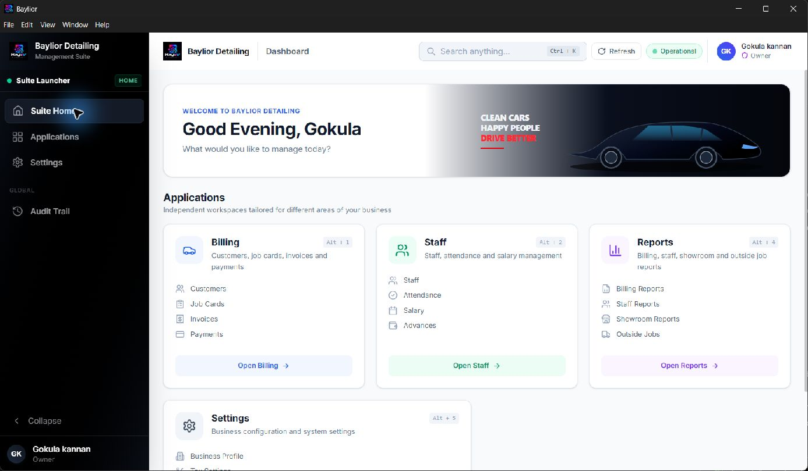
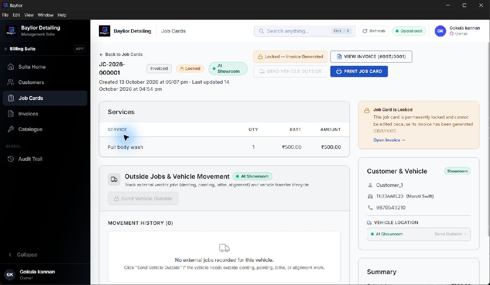
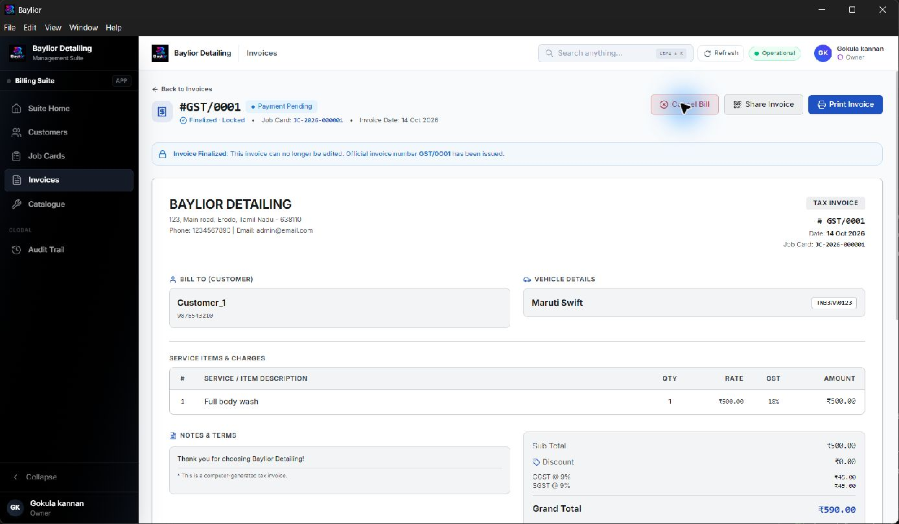
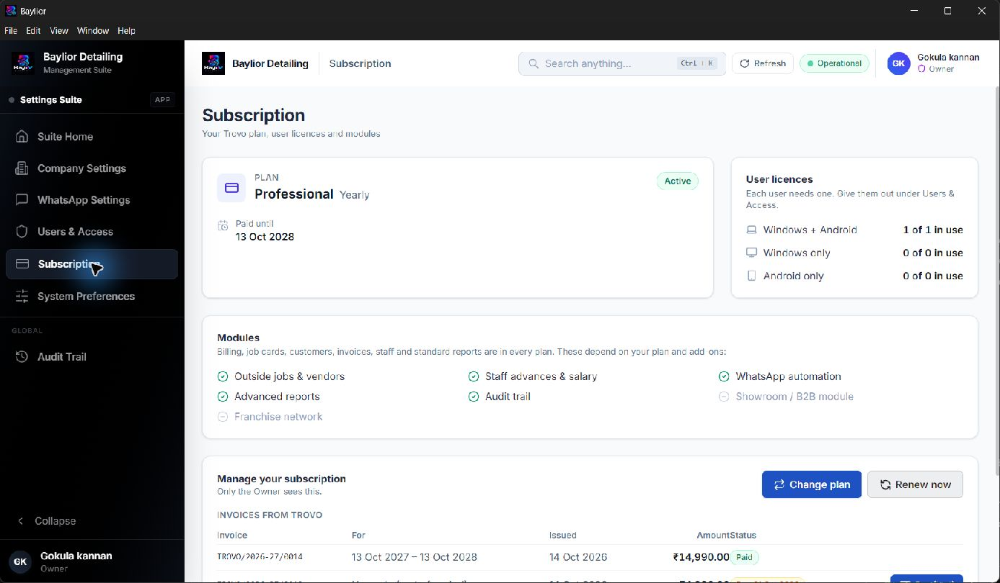

# Phase 1 review

14 October 2026. Content, assets and all four screenshots are approved by the user on 14 October 2026. Ready for Phase 2 local implementation; production catalogue/trial verification remains open for release. No Phase 2 page implementation or deployment has been performed.

- [Feature copy and claim evidence](CONTENT.md)
- [Brand asset and screenshot manifest](ASSETS.md)
- [Unresolved production settings](RELEASE_SETTINGS.md)
- [Local test catalogue snapshot](local-catalog.json)

## Dashboard / suite home

Retaken with the updated Baylior Detailing demo profile. The signed-in owner name remains visible. This is the real suite launcher. This does not depict analytics or daily revenue metrics.

## Job card

Real JC-2026-000001 with Full body wash, now showing Customer_1 and the invoiced/locked status. Contact and vehicle fields remain visible in the approved capture.

## Invoice

Created from the existing test job card at the user's request. GST/0001, INR 590, payment pending. No payment or customer communication was made. Reduced app zoom fits the service and total into the real screenshot. Retaken with Baylior Detailing, Customer_1 and the updated demo contact details. The user approved this capture with its visible demo fields.

## Subscription

Retaken showing the current Professional yearly subscription and Windows + Android licence. Its five included modules are enabled; Showroom / B2B and Franchise network remain disabled. Captured after the refresh completed. The displayed subscription invoice amount is test data, not a marketing price.

## Approval and release status

1. Final copy in CONTENT.md approved by the user on 14 October 2026.
2. Screenshot selection is approved: dashboard, job card, invoice and subscription, including the visible demo fields and owner name. Approval applies to the current PNG hashes in screenshot-hashes.json.
3. Confirm intended production catalogue URL/configuration when available. Until then use neutral signup wording and no fixed trial duration or prices.

E6 endorsement is omitted, as instructed. Brand identity and palette are already settled in design/brand; seven selected website assets have been copied and verified.

